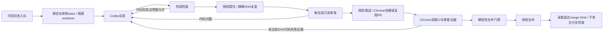

# 设计依据与可审查边界

## 材料分级

| 来源 | 材料含义 | 本轮处理 |
|---|---|---|
| AI开发方法与工作流整理 第4节 | Claude主控、Codex实现、GitHub循环的设计建议 | Codex-only短会话；保留薄调度器、外部状态、worktree与CI |
| 同文第4.1、4.8、4.9节 | 锁、幂等、预算、独立审查与硬验证原则 | 落实为SQLite事务、持久预算、SHA绑定和确定性门禁 |
| MaaS-Agent应用开发工作流第8节附近 | 历史人工合并与平台副作用边界 | 自动合并按本轮政策提案待确认；部署及真实平台操作不纳入 |
| MaaS需求反馈部分 | 实现、设计、真实使用失败有不同返回路径 | 需求矛盾保守停止；自检不代替用户验收 |
| 流程图片 | Claude/Sonnet角色及持续循环示意 | 只保留需要的职责，不以图上的型号和环境为已验证能力 |

两份原文及图片表达设计意图，不是部署证据。当前事实由本轮命令和浏览器观察提供。

## 关键链

任一步缺授权、环境失败、浏览器失败、冲突、未知证据或需求矛盾都保存当前位置并停止。错误不是一个无限重试分支。

## 可观察的不变量

1. 全局最多一个有效执行位置，旧PID未核对时不领取其他任务。
2. 同一幂等键和内容只创建一份任务，冲突内容被拒绝。
3. 提交、推送、创建PR、合并的授权分别读取本地人工配置。
4. 代码变化使旧检查与审查失效，base变化需要重新核对。
5. 外部动作前保存意图；恢复先看真实远端，避免重复创建或未知合并后重试。
6. 仅合并确认及主分支检查通过可写完成，不写用户接受。

## 外部能力依据

- Codex非交互执行、结构化输出与自动化认证：[官方文档](https://learn.chatgpt.com/docs/non-interactive-mode)。
- GitHub自动合并条件：[官方文档](https://docs.github.com/en/pull-requests/how-tos/merge-and-close-pull-requests/automatically-merging-a-pull-request)。
- 自动化身份触发后续CI的限制：[官方文档](https://docs.github.com/en/actions/how-tos/write-workflows/choose-when-workflows-run/trigger-a-workflow)。

官方支持说明可能的能力，本机预检和真实试点记录决定当前是否已可用。
